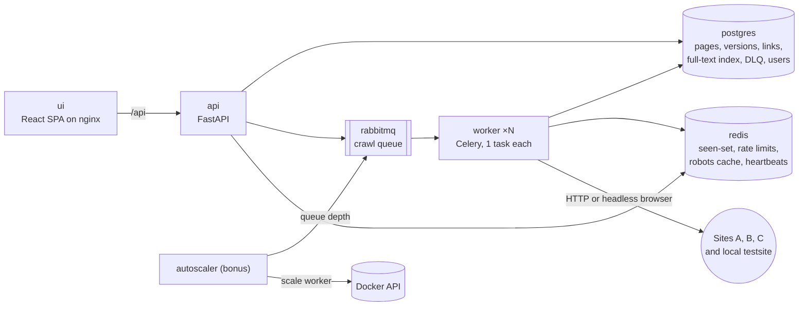

# Technology decisions

Each choice names one rejected alternative and the reason, as the report requires (section 5). Phase 2 reuses this codebase, so choices also favour what Phase 2 is likely to need.

## Architecture at a glance

Every box is its own container. Workers hold no state. They share only the queue (RabbitMQ), the database (Postgres) and the cache (Redis), which is what the rubric asks for.

## Choices

| Concern | Choice | Rejected | Why |
| --- | --- | --- | --- |
| Language | **Python 3.12** | TypeScript / Node | The work is mostly fetching, parsing, cleaning and validating HTML. Python has mature tools for each step (BeautifulSoup, Pydantic, Playwright, protego), and FastAPI generates the OpenAPI spec from the same Pydantic models. Node with BullMQ would also work, but the cleaning and validation code is shorter and clearer in Python. |
| Job queue | **Celery 5 with RabbitMQ as broker** | Celery with Redis as broker | `docker kill` on a worker closes its connection to RabbitMQ, and RabbitMQ re-queues the unacknowledged job **at once**. With Redis as broker, the job only comes back after a visibility timeout (one hour by default). Settings: `acks_late=True`, `reject_on_worker_lost=True`, `prefetch_multiplier=1`, concurrency 1 per container. |
| Shared coordination | **Redis 7** | Postgres advisory locks / tables | Rate limiting runs before every request from every worker, so it must be fast and atomic. A Lua token bucket in Redis runs as one atomic step. The seen-set (`SADD`), robots cache (TTL) and worker heartbeats (keys that expire) fit Redis well. |
| Primary database | **PostgreSQL 16** | MongoDB | Versions, links and crawls are relational. `INSERT … ON CONFLICT` makes writes idempotent. `JSONB` stores content blocks without losing structure. The built-in full-text search covers search, and `pgvector` can be added in the same database for Phase 2. |
| Full-text search | **Postgres `tsvector` + GIN index, `ts_headline` snippets** | Elasticsearch / Meilisearch | A real inverted index with highlighted snippets, and no extra service to keep in sync. At a few thousand documents Postgres is fast enough. |
| ORM and migrations | **SQLAlchemy 2 + Alembic** | Hand-written SQL files | Typed models, versioned migrations that run on startup, and plain SQL is still available where it reads better (FTS, upserts). |
| Static fetching | **httpx** | requests | Strict timeouts, connection pooling, sync and async clients, and easy `ETag` / `If-Modified-Since` requests. |
| JavaScript rendering | **Playwright (Chromium)**, only for sites configured `fetch_mode: browser` | Selenium | Waits for the network to go quiet and for selectors without extra setup, and has an official Docker image. The browser starts lazily, so static sites never pay for it. |
| HTML parsing | **BeautifulSoup 4 + lxml** | selectolax | Cleaning changes the page tree (removing nav, footer, ads). BeautifulSoup does this clearly, and lxml keeps it fast. selectolax is faster but its tree-editing API is thinner. |
| robots.txt | **protego** | `urllib.robotparser` (standard library) | protego follows RFC 9309: `*` and `$` wildcards, longest-match rule and `Crawl-delay`. The standard-library parser does not handle wildcards. |
| Document schema | **Pydantic v2** | Database constraints only | Rejections come with a readable reason we can log, and the same models feed the API docs. Database constraints stay as a second check. |
| API | **FastAPI** | Django REST Framework | OpenAPI/Swagger comes straight from type hints, and dependency-based role checks are short. DRF brings its own ORM and admin, which we do not need. |
| Auth | **JWT bearer tokens (PyJWT), Argon2 password hashes, users in Postgres** | Server-side sessions | Stateless, works the same for the SPA, curl and Swagger "Authorize". Roles are a claim checked by one FastAPI dependency. |
| Web UI | **React + Vite + TypeScript, served by nginx** (nginx also proxies `/api`) | Server-rendered Jinja + HTMX | A separate UI container that uses only the public API proves the API is complete, and a React app is easier to grow for Phase 2. The nginx proxy means no CORS setup. |
| Tables (extra content type) | **HTML tables stored as header + rows** | Linked PDF text extraction | Every theme has tables, and they need no extra libraries. PDFs can be added later if a site links many. |
| Tooling | **uv, ruff, pytest, mypy** | pip + flake8 + black | One fast tool for dependencies with a lockfile (reproducible CI), and one tool for lint and format. |
| CI | **GitHub Actions** | GitLab CI | The repository is on GitHub. |
| Failure and benchmark target | **Local `testsite` container** (FastAPI) | Real sites | Delays, 429s, always-failing URLs, editable pages and 500+ paginated pages on demand, without stressing anyone's server. |
| Autoscaling (bonus) | **Small `autoscaler` container: reads queue depth from the RabbitMQ management API, scales `worker` through the Docker API** | Kubernetes + KEDA | Stays within Docker Compose, which the brief already uses. |

## Branching

- `main` holds released work only. It gets the planning docs and the project skeleton now, and the finished Phase 1 at the end.
- `phase-1` holds all Phase 1 work, one commit per tracker task. When Phase 1 is complete, it merges into `main` through a pull request and is tagged `v1.0-phase1`.
- `phase-2` will branch from `main` after that merge.
