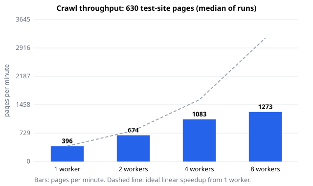

# Scaling benchmark

The same 630 test-site pages (30 catalog pages and 600 item pages) crawled with 1, 2, 4 and 8 workers, three runs each. Every run stores all 630 pages from scratch: fetch, clean, extract fields, validate, hash, write the version and its links, and enqueue the next links.



| Workers | Time (median) | Pages per minute | Speedup | Efficiency per worker | CPU per worker | PostgreSQL CPU |
| ---: | ---: | ---: | ---: | ---: | ---: | ---: |
| 1 | 95.4 s | 396 | 1.00× | 100% | 104% | 12% |
| 2 | 56.1 s | 674 | 1.70× | 85% | 74% | 19% |
| 4 | 34.9 s | 1,083 | 2.73× | 68% | 49% | 28% |
| 8 | 29.7 s | 1,273 | 3.21× | 40% | 30% | 38% |

Every run finished with all 630 pages stored. Runs at the same worker count differ by at most 3% (1 and 2 workers), 6% (4 workers) and 14% (8 workers). Raw data: [benchmark/results.csv](benchmark/results.csv).

## Where the speedup stops growing, and why

**It stops at the CPU, not at the queue.** All containers share one Docker Desktop virtual machine with 4 CPUs.

- **One worker is busy all the time.** A worker is one process that runs one job at a time, and it uses a full CPU (104%). Most of the work on a page is Python code: parsing the HTML twice (once for links and fields, once for cleaning), walking it into blocks, validating with Pydantic, and hashing. That takes about 150 ms per page. The test site's 50 ms of simulated latency is the only real waiting.
- **Adding workers splits the same 4 CPUs.** CPU per worker falls from 104% to 74%, then 49%, then 30%. At 8 workers, the workers, PostgreSQL and the test site together use about 300% of the 400% available. The rest goes to RabbitMQ, Redis, the `docker stats` sampling itself and the virtual machine's networking; those were not measured separately. A ninth worker would only make the others wait longer for a CPU.
- **That is why each step gains less.** Two workers almost double throughput, because there is spare CPU. Four workers still gain, but each one waits more. Eight workers gain only 18% over four, and per-worker efficiency falls to 40%.
- **PostgreSQL rises, but is not the limit yet.** Its CPU climbs with the write rate (12% → 38%). Each page takes about 20 small statements: lock the page row, then write the fetch, the version, its links and the crawl bookkeeping. On a machine with more cores, the database would be the next thing to watch.

**What did not limit it:**

| Candidate | Why it was not the limit |
| --- | --- |
| The per-domain rate limit | The test site allows 100 requests per second. At 8 workers the crawl made 21. |
| The test site | It stayed at 6–18% CPU. |
| The frontier and the shared seen-set | One Redis script call per page: about 21 a second at 8 workers, a tiny load for Redis. |
| The shape of the crawl | The catalog pages form a chain: page 2 is found on page 1, and so on. That chain is only about 30 page-times out of each run. |

## What this means for real sites

On the real sites, workers do not help much. That is by design. The shared per-domain rate limit allows only 2 requests per second for books.toscrape.com, 1 for Standard Ebooks, and 0.1 for Inventaire (its `Crawl-delay` is 10 s).

One worker already handles about 6.6 pages per second, which is more than any of those limits allow. A second worker would mostly wait for the shared token bucket. More workers pay off when a crawl covers several sites at once, each with its own limit, or a site that allows a higher rate.

## The first attempt, discarded

The first full run was noisy. One-worker runs went from 193 s down to 118 s, and the first run at each worker count was always the slowest. Two things caused this:

- **Other work on the machine.** I was running the test suite on the host at the same time, and Docker Desktop shares the host's CPUs.
- **Cold workers.** Freshly scaled containers had not yet imported their code, opened their connections or loaded robots.txt.

The script now runs a small, unrecorded warm-up crawl after every scale change, and the numbers above come from a run on an otherwise idle machine. Measured this way, the spread between runs at the same worker count fell from up to 65% to at most 14%.

## How to reproduce

```
docker compose up -d --build
uv run python scripts/benchmark.py                    # 1, 2, 4, 8 workers, 3 runs each (~15 min)
uv run python scripts/benchmark.py --workers 1 2 4 --runs 1
```

**What the script does:**
1. Scales the `worker` service and waits for each worker's heartbeat.
2. Runs the warm-up crawl.
3. Before each recorded run, deletes only the test site's pages, versions and crawls. Real-site data is never touched.
4. Starts a full crawl and times it from the database's `started_at` and `finished_at`.
5. Samples `docker stats` while the crawl runs.

It writes `docs/phase1/benchmark/results.csv` and `chart.svg`.

**Setup:**
- Windows 11 laptop, Docker Desktop virtual machine with 4 CPUs and 10 GB of memory.
- Test site latency `TESTSITE_LATENCY_MS=50`.
- One Celery process per worker container, with prefetch 1.
