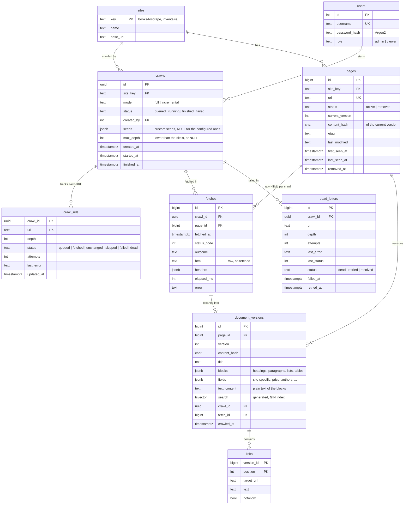

# Data model

PostgreSQL 16, created by Alembic migrations that the `migrate` service runs on every `docker compose up`. This is report section 4.

## Tables

| Table | One row is | Unique key (what makes a repeated job harmless) |
| --- | --- | --- |
| `sites` | A configured site, synced from `config/sites.yaml` | `key` |
| `crawls` | One crawl run of one site, full or incremental | `id` |
| `crawl_urls` | One URL's state inside one crawl | `(crawl_id, url)` |
| `pages` | A URL we have ever stored | `url` |
| `fetches` | The raw result of fetching a page in a crawl: HTML, status code, time | `(crawl_id, page_id)` |
| `document_versions` | One cleaned, validated version of a page | `(page_id, version)` |
| `links` | One link on one version: source, target URL, link text | `(version_id, position)` |
| `dead_letters` | A URL that failed N times in a crawl | `(crawl_id, url)` |
| `users` | A login with role `admin` or `viewer` | `username` |

## Why it looks like this

**Progress is counted, not incremented.** `GET /crawls/{id}` reports progress as `SELECT status, count(*) FROM crawl_urls WHERE crawl_id = … GROUP BY status`. A counter column would count a page twice if its job ran twice (jobs may run more than once). One row per URL, written with an upsert, cannot.

**Every write has a natural key.** Workers write with `INSERT … ON CONFLICT`, so running a job a second time finds the rows already there and changes nothing (task D7).

**Versioning.** A fetched page is cleaned and hashed. If the hash equals `pages.content_hash` (the current version), nothing new is stored: the crawl records `unchanged`. Otherwise a new `document_versions` row gets `version = current_version + 1`, and `pages` points at it. Old versions are never changed or deleted. The hash is deliberately *not* unique per page: content can go A → B → A, and that third state is a real new version.

**Conditional requests first.** `pages.etag` and `pages.last_modified` come from the last successful fetch. An incremental crawl sends them back; a `304 Not Modified` means `unchanged` without downloading or hashing anything (books.toscrape.com). Sites without these headers fall back to the content hash (Standard Ebooks, Inventaire).

**Removed pages stay.** A page that answers 404 or 410, or that a finished full crawl did not reach, gets `status = removed` and `removed_at`. Its versions remain readable, and it becomes `active` again if it reappears. "Did not reach" is only trusted when the crawl started from the site's configured seeds (`crawls.seeds` is NULL; a demo crawl of chosen URLs records them there) and did not run out of page budget. A page that was reached but failed (a 503, the dead-letter queue) stays active: it may only be down for a while.

**Links belong to a version.** A page's links change with its content. The links of the current version are "what this page links to now"; Phase 2 can follow `links.target_url` to `pages.url` to walk the graph.

**Search.** `document_versions.search` is a generated column: `setweight(to_tsvector('english', title), 'A') || setweight(to_tsvector('english', text_content), 'B')`, with a GIN index. PostgreSQL keeps it in sync automatically, and `ts_headline` builds highlighted snippets from `text_content`. This is a real inverted index, not `LIKE '%term%'`.

**Raw HTML size.** About 1,000 pages of 20–200 KB each. PostgreSQL compresses large text values (TOAST) automatically, so no separate file store is needed.
