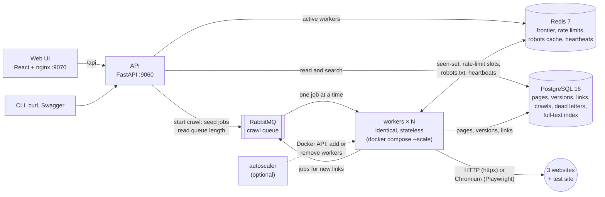
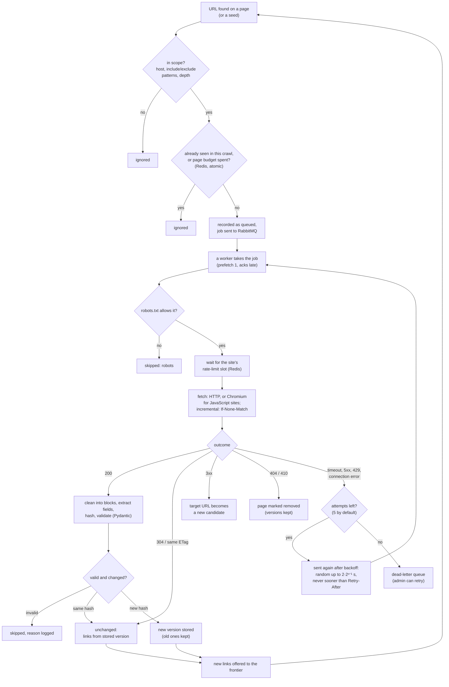
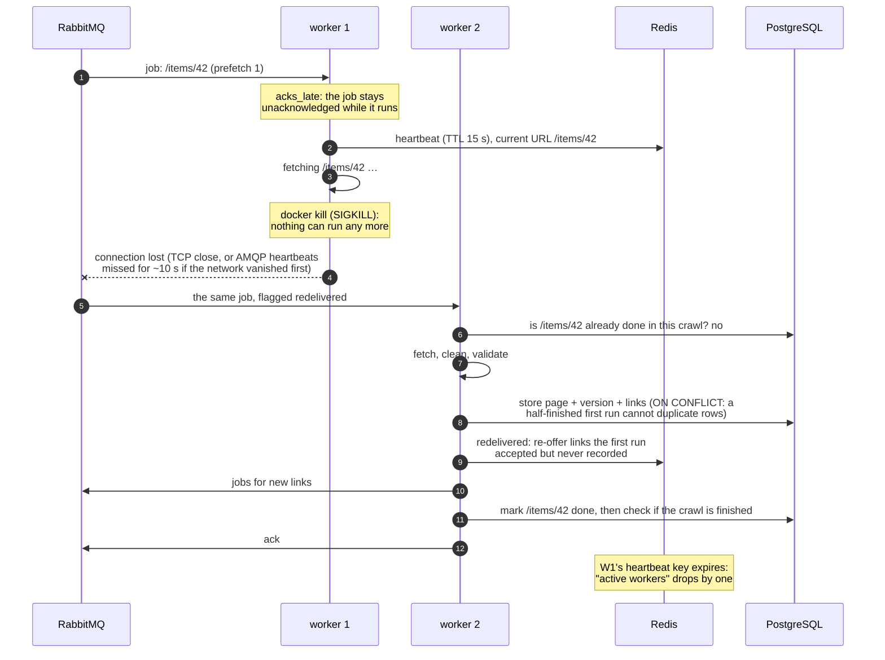
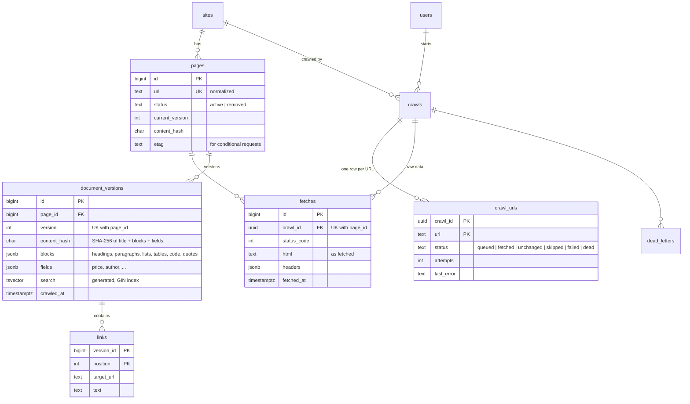
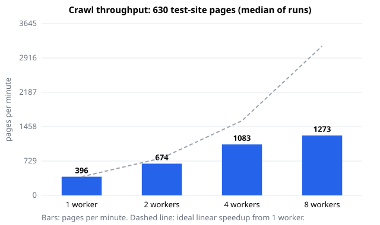

# onRamp Web Scraper — Phase 1 report

A distributed, fault-tolerant crawler for three book websites. It cleans and versions their pages and serves them through an authenticated API and a web UI. Code: https://github.com/FadelHmd7/onRamp-WebScraper (branch `phase-1`).

**Results in one table**

| | |
| --- | --- |
| Pages crawled from real sites | books.toscrape.com 300, Standard Ebooks 700, Inventaire 59 (the site went down twice mid-crawl; see 1.3) — no page failed while its site was up |
| Scaling | 396 → 674 → 1,083 → 1,273 pages per minute with 1, 2, 4, 8 workers (630-page test site) |
| Failure demos | worker killed mid-page, timeout, 429, always-failing page: all four recover as specified, scripted and repeatable |
| Tests | 760 Python tests (unit, integration with real PostgreSQL and Redis, browser) and 43 UI tests, all run in CI on every push |

---

## 1. Theme and sites

**Theme: books.** All three sites describe books, and two cover the same classics, so Phase 2 can combine them ("which Jane Austen novels have a free Standard Ebooks edition, and how many editions does Inventaire list?"). The Inventaire crawl is seeded from authors who are also on Standard Ebooks, so the overlap is there by design.

| | Site | Role | Why it fits |
| --- | --- | --- | --- |
| A | [books.toscrape.com](https://books.toscrape.com) | static HTML (the one sandbox) | 1,000 books with price, rating, stock and a product-information **table**, our extra content type |
| B | [inventaire.io](https://inventaire.io) | **rendered by JavaScript** | a single-page app: the raw HTML is a 4.9 KB shell; only a browser sees titles, authors and editions |
| C | [standardebooks.org](https://standardebooks.org) | **pagination, 500+ pages** | 129 catalog pages of 12 books each, plus a page per book |

Rejected along the way: a university-course theme (no compliant JavaScript or paginated site: one catalog asked for a 120 s crawl delay, another loaded its data from a host whose robots.txt forbids it), Project Gutenberg (its terms ask not to be crawled), Open Library (bulk users are pointed to data dumps). Details in [SITES.md](SITES.md).

### 1.1 What was crawled

| Site | Pages stored | Of which detail pages with site fields | Time | Failures |
| --- | ---: | ---: | ---: | ---: |
| books.toscrape.com | 300 (page budget) | 294 books: price, stock, rating, category, product table | 14 min | 0 |
| standardebooks.org | 700 (page budget) | 571 ebooks: author, abstract, word count, collections, language | 12 min | 0 |
| inventaire.io | 59 | 59 entities: name, type, authors, claims, dates; 7 with two versions | 2 runs, 1 page / 10 s | 0 while up; 28 dead letters during the second outage |

The first two full crawls ran at the same time on 4 workers, each site at its own rate. A sample of cleaned documents is in [exports/](../../exports/): 120 each from books.toscrape.com and Standard Ebooks, and all 59 from Inventaire.

### 1.2 What the real crawl taught us

Inventaire's first author pages were saved **before their list of works had loaded**: the entity name was on the page and the network was idle, but the app was still filling in sections (Mary Shelley's page had 0 links to works; a later rendering of the same page has 34). The fetcher now has a per-site *settle* step: after the usual waits it watches the page until it has not changed for 2 s (capped at 15 s). A test page that adds a section 1.5 s late reproduces the bug and proves the fix. The workers were rebuilt **in the middle of the crawl**: queued jobs stayed in RabbitMQ and the crawl continued under the new code, which is the at-least-once design doing its job.

### 1.3 Inventaire went down — twice

At 23 of 150 pages, inventaire.io began refusing connections — from our network and from a second, unrelated one, so an outage on their side rather than a block of this crawler. The crawler classified it correctly (connection refused is retryable, with backoff), but 127 queued pages × 5 attempts would have kept knocking on a failing site, so the crawl was **cancelled**: every queued job then ends without a request.

When the site came back, a new full crawl started from the configured seeds. Over 70 minutes it stored 36 new pages and re-rendered 11 of the earlier ones before the site failed again: 4 were unchanged, and **7 author pages got a second version** — Jane Austen, Mary Shelley, Mark Twain and Leo Tolstoy now with their works lists, the first real-site documents with a version history. Then inventaire.io refused connections again, from both networks. This time 28 pages exhausted their 5 attempts before the crawl was cancelled; they are in the dead-letter queue, where an admin can retry them once the site answers. Inventaire therefore has **59 documents, not the 100 the spec asks for** — a limit of the site's availability during this phase, not of the crawler, which stored every page it could reach.

Two of the 7 second versions (Samuel Johnson, Henry Fielding) are the same works in a different order: Inventaire does not sort these lists in a fixed way, and the content hash treats order as content. Sorting such lists before hashing would be wrong for most sites, so this is accepted noise for this one. One more went the wrong way: Charles Dickens's page was captured *before* its 159-work list appeared, though the settle step waited for 2 s of quiet. The settle step makes the race rare, not impossible; version 1, with the list, is kept in the history. A per-site selector that must appear before saving (for example the works section) is the Phase 2 fix.

---

## 2. Architecture and the life of a URL

Every box is its own container, started by one `docker compose up`. Workers keep no state: they share only the **queue** (RabbitMQ), the **database** (PostgreSQL) and the **cache** (Redis), so `--scale worker=N` gives N identical, independent workers.

- **Redis** holds what must be shared and fast: the crawl's *seen* set and page budget (one Lua script per page, so two workers can never both take the same link), a token bucket per host (one Lua script per request, so the rate holds however many workers there are), the robots.txt cache, and worker heartbeats (keys that expire).
- **PostgreSQL** holds what must last: pages, their versions as structured blocks, links, raw fetches, crawl progress, dead letters and users.
- **RabbitMQ** holds the work: one message per URL to crawl.

### The life of a URL, including retries

---

## 3. A worker crashing mid-job

Why nothing is lost or duplicated:

- **Nothing lost:** a job is acknowledged only after its last write (`acks_late`), and one worker holds one job at a time (`prefetch 1`). A dead worker's job goes back to the queue.
- **Nothing duplicated:** every write is keyed on a natural unique key — `(crawl, page)` for the raw fetch, `(page, version)` for versions, `(version, position)` for links — so running a job twice leaves the same rows. A test snapshots every row, stores the same result again (and six times concurrently), and compares.
- **No link forgotten:** a job records its children *before* it marks itself done, so a crawl cannot finish while a crashed job's links are missing; the redelivered job sends again any link its first run had taken in Redis but not recorded.

Measured (`scripts/demo/kill_worker.py`, three runs): another worker took the job over **5–12 s** after `docker kill`, the page was stored exactly once, and the heartbeat count dropped by one. The demo found one real problem on the way: a killed container does not always get to close its TCP connection, and RabbitMQ then learned of the death only from missed AMQP heartbeats — about 30 s with Celery's default of 120 s. Setting `broker_heartbeat=5` fixed it.

---

## 4. Data model and versioning

(Full columns, including `crawls`, `dead_letters` and `users`: [DATA_MODEL.md](DATA_MODEL.md).)

- **Raw data:** each fetch keeps the HTML, status code, headers and time, per crawl.
- **Cleaned document:** an ordered list of typed **blocks** — never one flattened text — plus site fields from CSS selectors, validated by a Pydantic schema; an invalid document is rejected with a logged reason. Tables keep rows and columns, with merged cells expanded and row headers marked.
- **Versioning:** the content hash covers title, blocks and fields (not the crawl time, not ads or scripts the cleaner removes). Same hash: no new version. Different hash: version + 1, old versions untouched. A→B→A is three versions. On an incremental crawl a `304` or an unchanged `ETag` decides without even downloading the page.
- **Removal:** a 404/410, or a page a finished full crawl did not reach, is marked `removed` with its versions kept — but only when the crawl started from the configured seeds and did not run out of page budget, because then "not reached" really means gone.
- **Links** belong to a version, so "what this page links to" changes with the page; Phase 2 can walk `links.target_url → pages.url`.
- **Search:** a generated `tsvector` column (title weight A, text weight B) with a GIN index — an inverted index, not `LIKE`. For a selective word PostgreSQL uses it unprompted (`Bitmap Index Scan on ix_document_versions_search`); for a word on every page it reads the table instead, which is cheaper.

---

## 5. Technology choices

| Concern | Choice | Rejected | Why |
| --- | --- | --- | --- |
| Job queue | **Celery on RabbitMQ** | Celery on Redis | A killed worker's unacknowledged job comes back at once with RabbitMQ; with Redis as broker it waits for a visibility timeout (an hour by default). |
| Coordination | **Redis** (Lua scripts) | PostgreSQL locks | The rate limiter runs before every request of every worker: it must be atomic and fast. |
| Database | **PostgreSQL 16** | MongoDB | Versions, links and crawls are relational; `ON CONFLICT` gives idempotent writes; `JSONB` keeps blocks structured; built-in full-text search. |
| Search | **tsvector + GIN + ts_headline** | Elasticsearch | A real inverted index with snippets and no second store to keep in sync at this size. |
| JavaScript pages | **Playwright (Chromium)**, only for browser sites | Selenium | Network-idle and selector waits built in; started lazily, so static sites never pay for it. |
| Parsing | **BeautifulSoup + lxml** | selectolax | Cleaning edits the tree (drops nav, ads, footers); BeautifulSoup's editing API is the clearest. |
| robots.txt | **protego** (RFC 9309) | `urllib.robotparser` | Wildcards, longest match and `Crawl-delay`; the standard-library parser has no wildcards. |
| Schema | **Pydantic v2** | database constraints only | Readable rejection reasons, and the same models document the API. |
| API | **FastAPI** + JWT (Argon2 hashes) | Django REST Framework | OpenAPI from type hints; one dependency per role check. |
| UI | **React + Vite + TypeScript** behind nginx | server-rendered pages | Uses only the public API (which proves it complete); nginx proxies `/api`, so no CORS. |
| Extra content type | **tables as rows and columns** | PDF text | Every site has tables (books.toscrape's product table); no extra libraries. |
| Failure testing | **local test site** | real sites | Delays, 429s, failing and editable pages on demand, without stressing anyone's server. |

Every choice with its reasoning: [DECISIONS.md](../DECISIONS.md).

---

## 6. Fault tolerance and scaling

### Failure scenarios

Each is a script in `scripts/demo/` that causes the failure on the test site, watches the system recover, and prints PASS or FAIL with the evidence (`run_all.py` runs all four):

| Scenario | What happens | Measured |
| --- | --- | --- |
| Worker killed mid-page | RabbitMQ redelivers the unacknowledged job to another worker | taken over in 5–12 s; page stored once; active workers −1 |
| Request times out | the 30 s read timeout fires; the job is retried after a backoff | stored on attempt 2 |
| 429 with `Retry-After: 10` | retried after exactly 10 s, and the host is paused for every worker meanwhile | `retry in 10.0s`; stored on attempt 2 |
| Page always fails | 5 attempts with growing, jittered delays (0.2, 2.6, 7.4, 13.2 s), then the dead-letter queue | dead with `HTTP 503`; admin retry → back in the queue when it fails again, `resolved` when it succeeds |

Also covered by tests: a job that crashes *after* storing its page (re-delivery leaves identical rows), eight workers storing the same page at once (the page-row lock serializes them), and a bug in the cleaner (counts as a failed attempt instead of looping). By design but not tested: when PostgreSQL or Redis is briefly down the pipeline cannot even record an attempt, so Celery itself re-publishes the job with backoff (up to 12 times).

### Scaling benchmark

The same 630 test-site pages, stored from scratch, three runs per worker count, on an otherwise idle machine (Docker Desktop VM, 4 CPUs):

| Workers | Time (median) | Pages/min | Speedup | Per-worker efficiency |
| ---: | ---: | ---: | ---: | ---: |
| 1 | 95.4 s | 396 | 1.00× | 100% |
| 2 | 56.1 s | 674 | 1.70× | 85% |
| 4 | 34.9 s | 1,083 | 2.73× | 68% |
| 8 | 29.7 s | 1,273 | 3.21× | 40% |

**Where it stops, and why: the CPU.** One worker keeps a full CPU busy (104%) — parsing, cleaning, validating and hashing in Python take ~150 ms of the page's time; the test site's 50 ms latency is the only real waiting. More workers split the same 4 CPUs: CPU per worker falls 104% → 74% → 49% → 30%, and at 8 workers the workers, PostgreSQL and the test site together use ~300% of the 400% available. PostgreSQL rises with the write rate (12% → 38%) but is not the limit yet. The rate limiter (100 req/s for the test site; 21/s were used) and Redis were not limits either.

**On the real sites, politeness is the limit, by design.** One worker handles ~6.6 pages/s, more than any site allows (2, 1 and 0.1 requests per second). Extra workers pay off when several sites are crawled at once. One limitation showed during the real crawls: all sites share one queue, so workers waiting for a slow site's rate-limit slot are not free for a faster one (books.toscrape took 14 min instead of ~3 while it shared workers with Standard Ebooks). Per-site queues would remove this.

**Bonus — autoscaling:** an optional container reads the queue backlog every 5 s and scales `worker` through the Docker API: one worker per 25 waiting jobs, 1 to 8, up at once, down one at a time after 30 s of low backlog. Measured: 1 → 8 workers within 49 s of a crawl starting, back to 1 about 3.5 minutes after the queue drained, the crawl unaffected (630/630).

Details and raw data: [BENCHMARK.md](BENCHMARK.md).

---

## 7. Compliance

Rules for every site: robots.txt is checked before **every** request (protego, cached per host in Redis); our URL patterns only narrow the crawl further. Every request names the project: `onRamp-WebScraper/0.1 (+https://github.com/FadelHmd7/onRamp-WebScraper)`. One rate limit per host is shared by all workers; 429 and 503 back off and honour `Retry-After`. No logins, paywalls, CAPTCHAs or bot-detection bypass. `nofollow` links are stored but never followed. Re-crawls use conditional requests where a site supports them.

| | books.toscrape.com | inventaire.io | standardebooks.org |
| --- | --- | --- | --- |
| robots.txt | 404: nothing disallowed | disallows `/entity/*/*`, `/items`, `/search`, …; **Crawl-delay 10** | `User-agent: *`: only `/honeypot`; a stricter group for named SEO/AI bots does not apply to us |
| What we crawl | home, listings, book pages | only `/entity/<id>` pages, all allowed; the app's data comes from the same host, also allowed | listings and book pages; downloads and full texts skipped by choice |
| Terms | a scraping sandbox ("We love being scraped!"); prices are random and never presented as real | non-profit; entity data CC0; no usage restrictions | own work CC0, texts U.S. public domain |
| Our rate | 2 req/s | 1 req / 10 s (its crawl delay; a page load counts as one) | 1 req/s (small volunteer project) |
| Re-crawls | conditional requests (it sends ETag) | content hash | content hash (no ETag) |

The hidden honeypot link on Standard Ebooks is both disallowed and `nofollow`; the crawler never requests it. When Inventaire started failing, the crawl was stopped rather than left retrying. Per-site details: [COMPLIANCE.md](COMPLIANCE.md).
